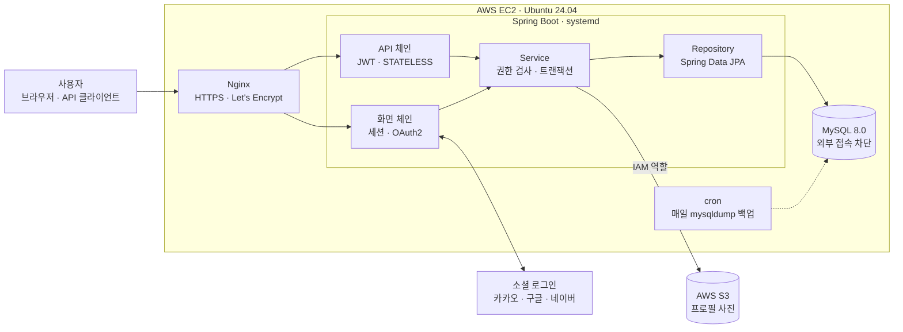

# 🍇 Podo — 더치페이 정산 웹 서비스

> 여행·회식 비용을 방 단위로 모아 **"누가 누구에게 얼마?"** 를 자동으로 계산해 주는 서비스입니다.
> 기획부터 개발, AWS 배포와 운영까지 혼자 진행한 개인 프로젝트입니다.

- **서비스 주소**: https://podopay.shop
- **개발 기간**: 2026.04 ~ 2026.10
- **형태**: 1인 개인 프로젝트 (백엔드 · 화면 · 인프라 · 운영)

<br>

## 목차

1. [주요 기능](#주요-기능)
2. [기술 스택](#기술-스택)
3. [아키텍처](#아키텍처)
4. [핵심 설계 결정](#핵심-설계-결정)
5. [트러블슈팅](#트러블슈팅)
6. [프로젝트 구조](#프로젝트-구조)
7. [로컬 실행 방법](#로컬-실행-방법)
8. [다음 단계](#다음-단계)

<br>

## 주요 기능

| 분류 | 기능 |
| --- | --- |
| 회원 | 자체 회원가입(아이디·이메일 중복 확인), 카카오·구글·네이버 소셜 로그인, 마이페이지, 프로필 사진(S3) |
| 정산방 | 방 생성, 멤버 검색·초대, 방장·멤버 권한 구분, 멤버별 계좌 목록 관리 |
| 결제·정산 | 항목별 결제자·참여자·금액 입력, 절사 옵션, 결제일·마감일, 정산 결과와 공유 문구 |
| 고객센터 | 공지사항·FAQ(비로그인 열람 가능), 1:1 문의 |
| 백오피스 | 사용자·관리자 계정 관리, 정산방 조회, 공지·FAQ 관리, 문의 답변 |
| REST API | 정산방·결제·정산·회원 검색 API (`/api/**`), JWT 인증, Swagger 문서 |

<br>

## 기술 스택

| 영역 | 사용 기술 |
| --- | --- |
| 언어·프레임워크 | Java 21, Spring Boot 3.5, Spring MVC, Spring Data JPA |
| 화면 | Thymeleaf (서버 사이드 렌더링), HTML, CSS, JavaScript |
| 인증·보안 | Spring Security, JWT, OAuth2 (카카오·구글·네이버) |
| API 문서 | springdoc-openapi (Swagger UI, Bearer 인증) |
| DB | MySQL 8.0 (운영), H2 (개발·테스트) |
| 스토리지 | AWS S3 (AWS SDK v2) |
| 인프라 | AWS EC2 (Ubuntu 24.04), Nginx, Let's Encrypt, systemd, cron |
| 도구 | Gradle, IntelliJ, Git |

<br>

## 아키텍처



- Nginx가 HTTPS(443)를 받아 Spring Boot(8080)로 전달합니다. 인증서는 Let's Encrypt로 자동 갱신합니다.
- 앱은 systemd 서비스로 실행해, 서버가 재부팅되거나 프로세스가 종료되어도 자동으로 다시 시작합니다.
- DB 계정, JWT 키, OAuth 키 같은 비밀 값은 코드에 두지 않고 서버의 환경변수 파일에서 주입합니다.
- S3는 액세스 키 없이 EC2에 붙인 IAM 역할로 접근합니다.

<br>

## 핵심 설계 결정

### 1. 화면은 세션, API는 JWT로 인증 분리

`SecurityFilterChain`을 두 개로 나눴습니다.

| 구분 | 화면 (HTML) | API (`/api/**`) |
| --- | --- | --- |
| 인증 | 폼 로그인 + OAuth2 소셜 로그인 | JWT (Access 1시간, Refresh 2주) |
| 상태 | 서버가 세션 보관 | STATELESS |
| 인증 실패 시 | 로그인 화면으로 이동 | 401 · 403 JSON 응답 |
| CSRF | 사용 | 사용 안 함 |
| 예외 처리 | `GlobalExceptionHandler` | `ApiExceptionHandler` |

- **이유**: 하나의 체인으로 처리하면 API 요청도 로그인 HTML로 리다이렉트되어, 실패 처리를 분리했습니다.
- Refresh 토큰은 사용자당 1개만 DB에 저장하고 재발급할 때 교체해, 서버가 토큰을 무효화할 수 있게 했습니다.
- 방장·결제자만 할 수 있는 작업은 서비스 계층에서 검사하고, `NotRoomOwnerException`처럼 이름 있는 예외로 응답합니다.

### 2. 프로필 사진 업로드를 보안과 정합성 기준으로 설계

- **검증**: 확장자나 Content-Type이 아니라 **파일 시그니처(매직 바이트)** 로 JPG·PNG·WEBP만 허용합니다. 스크립트를 넣을 수 있는 SVG는 거부하고, 크기는 5MB로 제한합니다.
- **저장**: S3 키는 `profiles/{userId}/{uuid}.ext`로 만들어 이름 충돌과 추측을 막고, 공개 읽기는 `profiles/*` 경로만 허용했습니다.
- **정합성**: 이전 사진은 DB 커밋이 성공한 뒤(`afterCommit`)에만 S3에서 삭제합니다. DB 저장이 롤백되어도 사용자의 사진이 깨지지 않습니다.

### 3. 비용을 줄이고 운영을 직접 맡기

개인 프로젝트의 월 고정비를 줄이기 위해 DB를 **AWS RDS에서 EC2 내부 MySQL로 이전**했고, 그만큼 생기는 관리 부담을 아래처럼 보완했습니다.

- MySQL을 `127.0.0.1`에만 열어 외부 접속 차단
- 1GB 메모리 서버에 맞게 스왑 1GB 추가, InnoDB 버퍼 128MB, 최대 연결 30개로 조정
- cron으로 매일 mysqldump 백업, 7일 보관 (서버 시계가 UTC라 한국 시간 03:00에 맞춤)
- 재부팅 후 자동 기동, 인증서 갱신 테스트, 메모리 부족(OOM) 로그 점검

<br>

## 트러블슈팅

<details>
<summary><b>비로그인 사용자의 공지 페이지가 로그인 화면으로 이동</b></summary>

- **증상**: `/notices/**`를 `permitAll()`로 열었는데도 로그아웃 상태에서 공지 페이지가 열리지 않음
- **원인**: 보안 설정이 아니라, 헤더 템플릿이 로그인 여부를 확인하지 않고 `principal.user`를 읽음. 비로그인 사용자의 principal은 문자열 `"anonymousUser"`라 템플릿 에러(500) 발생
- **해결**: 아바타·로그아웃 영역을 `th:if`로 감싸 로그인 사용자에게만 표시
- **배운 점**: 브라우저 Network 탭의 302만 보고 추측하지 않고, `logging.level.org.springframework.security: DEBUG`로 서버 로그의 스택트레이스부터 확인한다
</details>

<details>
<summary><b>계좌 등록 시 모든 필드가 번갈아 검증 실패</b></summary>

- **증상**: 값을 모두 입력했는데도 시도할 때마다 다른 필드의 "필수 입력" 에러가 표시됨
- **원인**: 요청 DTO에 `@Setter`가 없어 `@ModelAttribute` 바인딩 시 값이 전부 null. 여러 검증이 동시에 실패하면 순서가 보장되지 않아 에러가 번갈아 보였음
- **해결**: DTO에 `@Setter` 추가
- **배운 점**: 개발자 도구로 전송 값이 정상인데도 모든 필드가 실패하면 바인딩부터 의심한다
</details>

<details>
<summary><b>결제 추가 화면에서 결제자 이름이 빈칸, 에러는 없음</b></summary>

- **증상**: 로그인 사용자의 이름이 비어 있고 방장 여부가 항상 false
- **원인**: 해당 컨트롤러 메서드에만 `@AuthenticationPrincipal`이 빠져, 로그인 사용자 대신 빈 객체가 주입됨
- **해결**: 어노테이션 추가 후 비슷한 메서드를 하나씩 모두 확인
- **배운 점**: "값이 비었는데 에러는 없다"면 인자 주입 누락을 의심한다
</details>

<details>
<summary><b>정산·정산 취소 버튼 중 하나만 500 에러</b></summary>

- **증상**: 같은 화면의 두 버튼 중 하나만 실패
- **원인**: 복사해 만든 두 메서드의 `@RequestParam` 이름과 폼의 hidden input 이름이 서로 달라 필수 파라미터 누락
- **해결**: 두 엔드포인트와 폼의 파라미터 이름을 `participants`로 통일
- **배운 점**: 복사해 만든 짝 메서드는 파라미터 이름부터 대조한다
</details>

<details>
<summary><b>사이트와 SSH가 모두 응답 없음</b></summary>

- **증상**: 웹사이트와 SSH 접속이 동시에 끊김
- **원인**: EC2 상태 검사 중 인스턴스(OS) 상태만 실패, 시스템·EBS 상태는 정상
- **해결**: 리전과 실패 항목을 구분해 확인한 뒤 재부팅으로 복구, 확인 순서를 문서로 정리
</details>

<br>

## 프로젝트 구조

```
src/main/java/com/podo
├── api          # REST API 컨트롤러 (/api/**)
├── domain       # 도메인별 entity · repository · service · controller · dto
│   ├── payroom  #   정산방, 멤버, 결제, 참여자, 계좌, 정산
│   ├── user     #   회원, 마이페이지, 관리자 회원 관리
│   └── ...      #   공지, FAQ, 1:1 문의, 관리자 화면
└── global       # 공통 설정
    ├── config   #   Spring Security 등 설정
    ├── security #   JWT, OAuth2, 인증 실패 처리
    ├── exception#   ErrorCode, 예외 핸들러
    ├── storage  #   S3 프로필 이미지 저장소
    └── common   #   ApiResponse, BaseEntity
```

<br>

## 로컬 실행 방법

**요구 사항**: Java 21

```bash
git clone https://github.com/damsul/podo.git
cd podo
./gradlew bootRun --args='--spring.profiles.active=dev'
```

개발 프로필(`dev`)은 H2 데이터베이스를 사용합니다. 아래 환경변수가 필요합니다.

| 환경변수 | 설명 |
| --- | --- |
| `JWT_SECRET` | JWT 서명 키 (Base64) |
| `KAKAO_CLIENT_ID`, `KAKAO_CLIENT_SECRET` | 카카오 로그인 |
| `GOOGLE_CLIENT_ID`, `GOOGLE_CLIENT_SECRET` | 구글 로그인 |
| `NAVER_CLIENT_ID`, `NAVER_CLIENT_SECRET` | 네이버 로그인 |
| `DB_PASSWORD` | 운영 DB 비밀번호 (`prod` 프로필) |

API 문서는 실행 후 `http://localhost:8080/swagger-ui.html`에서 확인할 수 있습니다.

<br>

## 다음 단계

- **CI/CD**: GitHub Actions로 빌드·배포 자동화 (현재는 수동 재배포: 빌드 → scp → `systemctl restart`)
- **정산 통계 API**: 월별·방별 지출 집계
- **백업 보관 위치 분리**: 백업 파일을 S3에 따로 보관
